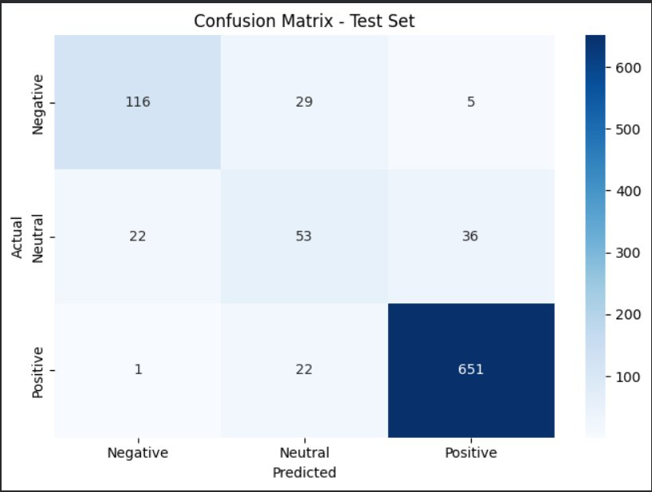
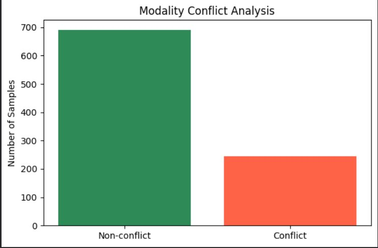
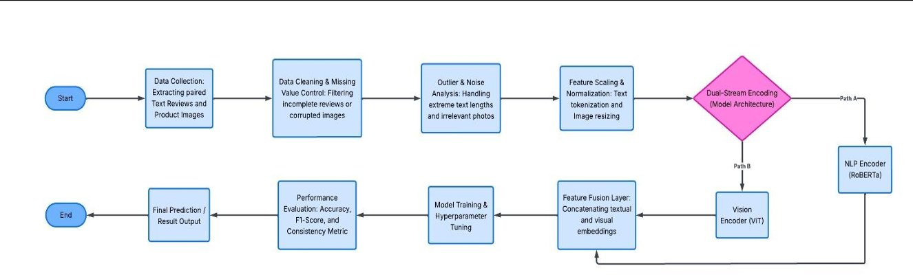
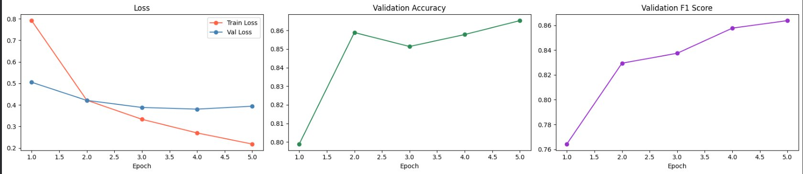

# Multimodal Sentiment Analysis & Conflict Detection

Sentiment classification of Yelp food reviews using **both the review text and the food photo**, plus a metric that detects when the two disagree.

> Machine Learning course project by **Ahmet Kaan Kavaz** and **Kutlay Kavkas** (Computer Engineering, Istanbul Commerce University).
> Full write-up: [IEEE-format report (PDF)](report/IEEE_Report_Multimodal_Sentiment_Analysis.pdf)

## Why

Most sentiment models only read the text. In food reviews that misses a lot: a glowing review can come with a photo of cold, undercooked food, and vice versa. This project combines a language model and a vision model, and measures how often text and image tell different stories.

## Results

| Metric | Value |
|---|---|
| Test accuracy | **87.70%** |
| Weighted F1-score | **0.8744** |
| Consistency score (text and image agree) | 0.739 |
| Accuracy when text and image agree | 94.07% |
| Accuracy when they conflict (26.1% of test samples) | 69.67% |

| Class | Precision | Recall | F1 |
|---|---|---|---|
| Negative | 0.83 | 0.77 | 0.80 |
| Neutral | 0.51 | 0.48 | 0.49 |
| Positive | 0.94 | 0.97 | 0.95 |

The 24-point accuracy gap between agreeing and conflicting samples shows that text–image conflict is a real source of error that text-only systems ignore.

<p align="center">
  
  
</p>

## Pipeline



1. **Data collection:** filter food businesses from the Yelp Open Dataset and join their reviews with food-labeled photos.
2. **Cleaning:** drop rows with missing text or photos, verify image files are not corrupted.
3. **Outlier handling:** keep reviews within the 5th–95th percentile of text length, drop images smaller than 64×64 px.
4. **Labeling and preprocessing:** 1–2 stars → Negative, 3 → Neutral, 4–5 → Positive; RoBERTa tokenization (max 128 tokens); images resized to 224×224 and normalized.
5. **Split:** stratified 70 / 15 / 15 train / validation / test.
6. **Model training and evaluation** (below).

## Model

| Component | Details |
|---|---|
| Text encoder | `roberta-base`, [CLS] embedding (768-d) |
| Image encoder | `google/vit-base-patch16-224`, [CLS] embedding (768-d) |
| Fusion | Late fusion by concatenation (1536-d) |
| Classifier | MLP 1536 → 512 → 128 → 3, ReLU, dropout 0.3 |
| Training | AdamW (lr 2e-5, weight decay 0.01), linear warmup (10%), 5 epochs, batch size 8, gradient clipping 1.0, best checkpoint by validation F1 |
| Hardware | NVIDIA T4 (Google Colab) |

**Conflict detection:** the text and image streams are run independently through the classifier (the other modality zeroed out). A sample is flagged as conflicting when the two predictions differ.



## Run it

The notebook is written for Google Colab with a GPU runtime.

1. Download the [Yelp Open Dataset](https://www.yelp.com/dataset) (JSON files and photos). The dataset is not included in this repository because of its size and license.
2. Upload these files to `MyDrive/yelp_data/` in Google Drive:
   - `yelp_academic_dataset_business.json`
   - `yelp_academic_dataset_review.json`
   - `photos.json`
   - `photos.zip`
3. Open `multimodal_sentiment_analysis.ipynb` in Colab and run all cells. Paths can be changed in the *Mount Google Drive & Configure Paths* cell.

To run locally instead: `pip install -r requirements.txt`, then update the paths in the notebook and skip the Google Drive cell.

## Tech stack

Python · PyTorch · Hugging Face Transformers · torchvision · scikit-learn · Pandas · NumPy · Matplotlib · Seaborn

## Repository structure

```
├── multimodal_sentiment_analysis.ipynb   # full pipeline: data → training → evaluation → demo
├── report/
│   └── IEEE_Report_Multimodal_Sentiment_Analysis.pdf
├── assets/                               # figures used in this README
└── requirements.txt
```

## Authors

- Ahmet Kaan Kavaz
- Kutlay Kavkas ([GitHub](https://github.com/Kutlayy) · [LinkedIn](https://www.linkedin.com/in/kutlay-kavkas-aab335262/))
